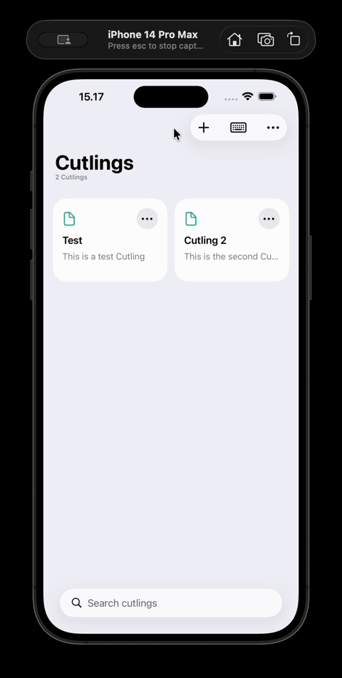

# Cutling

<p>
<a href="https://macbrowse.com"></a>
<a href="https://macappindex.com/apps/cutling?ref=badge"></a>
<a href="https://macpip.com/apps/cutling?ref=badge"></a>
<a href="https://nativeshelf.com/cutling?ref=badge"></a>
<a href="https://ipip.fyi/apps/cutling?ref=badge"></a>
<a href="https://postyourstartup.com/startup/cutling?ref=badge"></a>
<a href="https://launchigniter.com/product/cutling?ref=badge-cutling"></a>
<a href="https://ailaun.ch/projects/cutling?utm_source=badge"></a>
<a href="https://www.nxgntools.com/tools/cutling?utm_source=cutling"></a>
<a href="https://dodolaunch.com/p/cutling?ref=badge"></a>
<a href="https://alternativeto.net/software/cutling/about/?utm_source=badge&utm_medium=referral"></a>
<a href="https://indieappcatalog.com/app/5527"></a>
<a href="https://macbase.app/apps/cutling?ref=badge"></a>
<a href="https://macnative.io/apps/cutling?utm_source=macnative-badge&utm_medium=referral"></a>
</p>

**Your clipboard, organized.**

Cutling is a native iOS and macOS clipboard manager that puts your most-used text and images one tap away. Save snippets and access them instantly from any app via a custom keyboard extension — no accounts, no tracking, just your stuff.

[](https://apps.apple.com/app/apple-store/id6759476314?pt=127609326&ct=github-readme&mt=8)



---

## Features

### Core Functionality

- **Text Snippets** — Save up to 1,000 text cutlings, each up to 1,000 characters
- **Image Cutlings** — Save up to 100 images for quick access (QR codes, signatures, diagrams)
- **Custom Keyboard Extension** — Insert cutlings from any app without switching. One tap to paste
- **Icons & Colors** — Choose from 750+ SF Symbols and 12 colors to organize your collection
- **Expiration Dates** — Set auto-delete dates for temporary snippets
- **iCloud Sync** — Keep cutlings in sync across iPhone, iPad, and Mac (optional)
- **Recently Deleted** — Recover accidentally deleted cutlings within 30 days

### Smart Features

- **Input Type Detection** — Automatically categorizes cutlings (email, URL, phone, name, address) using `NSDataDetector` and `NLTagger`
- **Context-Aware Keyboard** — Shows relevant cutlings based on the current text field's content type
- **Background App Refresh** — Syncs in the background when enabled

---

## Privacy First

Cutling is built with privacy at its core:

- **No accounts required**
- **No ads**
- **No tracking or analytics**
- **No crash reports**
- **No third-party SDKs**
- **Local storage** with optional iCloud sync
- **One-time purchase** — no subscriptions, no in-app purchases

Your cutlings stay on your device — or in your personal iCloud account if you choose to enable sync. The developer cannot access your data, period.

---

## Requirements

| Platform | Minimum Version |
|----------|-----------------|
| iOS      | iOS 18.0+       |
| macOS    | macOS 15.0+     |

---

## Installation

### From App Store

Download Cutling from the [App Store](https://apps.apple.com/app/apple-store/id6759476314?pt=127609326&ct=github-readme&mt=8).

### Building from Source

1. Clone the repository:
   ```bash
   git clone https://github.com/yourusername/Cutling.git
   cd Cutling
   ```

2. Open `Cutling.xcodeproj` in Xcode (latest version recommended)

3. Select your development team in the project settings

4. Build and run:
   - **iOS**: Select an iOS simulator or device and press `Cmd + R`
   - **macOS**: Select "My Mac" and press `Cmd + R`

---

## Development

### Tech Stack

- **Language**: Swift
- **UI Framework**: SwiftUI
- **Data Persistence**: JSON files in the App Group container + CloudKit
- **Sync Engine**: `CKSyncEngine` for iCloud synchronization
- **Testing**: XCUITest for UI testing and screenshots

### Project Structure

```
Cutling/
├── Cutling/                    # Main app target (iOS/macOS)
│   ├── CutlingApp.swift        # App entry point
│   ├── Cutling.swift           # Core data model
│   ├── CutlingStore.swift      # Data persistence layer
│   ├── MainContentView.swift   # Main grid view
│   ├── TextDetailView.swift    # Text cutling editor
│   ├── ImageDetailView.swift   # Image cutling editor
│   ├── SettingsView.swift      # Settings & keyboard setup
│   ├── CloudKitSyncManager.swift
│   └── ...
├── CutlingKeyboard/            # Keyboard extension
│   ├── KeyboardViewController.swift
│   └── ...
├── CutlingUITests/             # UI Test target
├── fastlane/                   # Deployment automation
│   ├── Fastfile
│   ├── Snapfile
│   └── metadata/
├── docs/                       # Marketing website (GitHub Pages)
└── ...
```

### Running UI Tests for Screenshots

The project uses fastlane's snapshot tool for automated screenshots:

```bash
# Install dependencies
brew install imagemagick

# Run snapshot
fastlane ios screenshots
```

### Deployment

The project uses fastlane for automated App Store deployment:

```bash
# Upload screenshots
fastlane ios screenshots

# Add device frames with marketing text
fastlane ios framed_screenshots

# Upload metadata to App Store Connect
fastlane ios upload_metadata

# Full deployment
fastlane ios deploy
```

See [fastlane/README.md](fastlane/README.md) for details.

---

## Localization

Cutling supports **50+ languages** including:

- European: English, Deutsch, Français, Español, Italiano, and more
- Asian: 日本語，한국어，简体中文，繁體中文, and more
- RTL: العربية, עברית, فارسی, اردو

See [locales.json](locales.json) for the complete list.

---

## Keyboard Setup

1. Open Cutling and tap "Set up Keyboard"
2. Go to Settings > General > Keyboard > Keyboards
3. Tap "Add New Keyboard..." and select "Cutling"
4. Tap "Cutling" and enable "Allow Full Access" (required for paste functionality)
5. Return to any app and long-press the globe key to switch to Cutling

---

## App Group

Cutling uses an App Group (`group.com.matsuokengo.Cutling`) to share data between the main app and the keyboard extension. Both targets must have the same App Group capability enabled in Xcode.

---

## Limits

| Type            | Limit          |
|-----------------|----------------|
| Text cutlings   | 1,000          |
| Image cutlings  | 100            |
| Total cutlings  | 1,100          |
| Text length     | 1,000 chars    |

---

## License

**All Rights Reserved.**

Copyright (c) 2026 Kenneth Johannes Fang.

Cutling is a commercial app available on the App Store. This source code is provided for **transparency only** — **no license is granted** to copy, modify, distribute, or create derivative works.

See the [LICENSE](LICENSE) file for full terms.

---

## Contact

- **Website**: [cutling.matsuokengo.com](https://cutling.matsuokengo.com/)
- **Support**: [cutling.matsuokengo.com/support](https://cutling.matsuokengo.com/support/)
- **FAQ**: [cutling.matsuokengo.com/faq](https://cutling.matsuokengo.com/faq/)
- **Privacy Policy**: [cutling.matsuokengo.com/privacy](https://cutling.matsuokengo.com/privacy/)

---

*Built with SwiftUI for iOS and macOS.*
